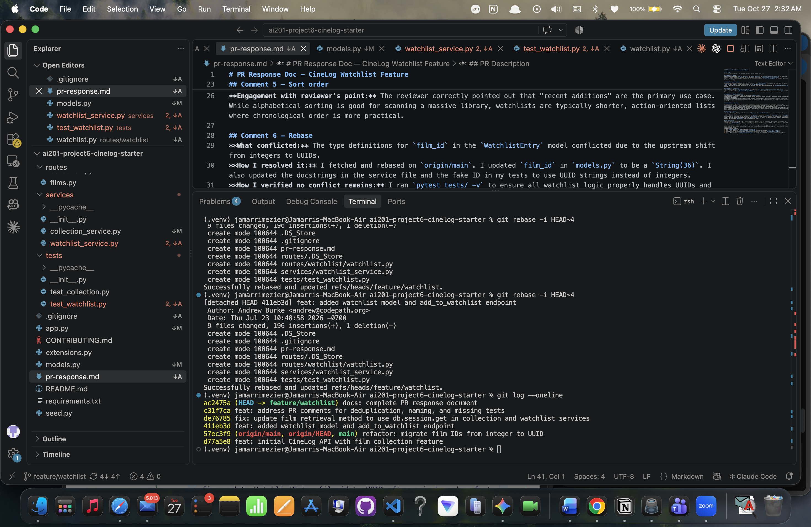

# PR Response Doc — CineLog Watchlist Feature

## AI Usage
During this project, I used AI tools primarily for codebase orientation, Git troubleshooting, and format verification:

1. **Understanding Codebase Patterns:** Before writing the deduplication logic for the watchlist, I provided the existing `add_to_collection` function to the AI and asked it to break down how the duplicate checking and exception handling worked. This ensured I accurately replicated the project's established pattern for my new endpoint.
2. **Rebase Conflict Resolution:** When rebasing on `origin/main`, I encountered merge conflicts due to the upstream shift from integers to UUIDs. I used the AI as a sounding board to help identify the conflicting lines in `models.py` and verify the proper SQLAlchemy syntax for defining the new UUID columns.
3. **Commit History Verification:** Before finalizing my PR, I provided my `git log --oneline` output to the AI to verify that my rewritten commit messages strictly followed the conventional commit format (feat, fix, docs) and that no merge commits remained in the tree.

## Comment 1 — Rename
**What I did:** Renamed `save_to_watchlist` to `add_to_watchlist` in `services/watchlist_service.py` to match the project's naming convention. Updated the corresponding call site in `routes/watchlist/watchlist.py`.
**How I verified:** Searched the codebase for any remaining instances of `save_to_watchlist` and verified the route functions correctly.

## Comment 2 — Deduplication
**What I did:** Added a database query before creating a new `WatchlistEntry` to check if an entry with the given `user_id` and `film_id` already exists. Added an `AlreadyInWatchlistError`.
**How I verified:** Tested by attempting to add the same film twice and confirming that an `AlreadyInWatchlistError` is raised.

## Comment 3 — Missing test
**What I did:** Created `tests/test_watchlist.py` and wrote `test_add_to_watchlist_nonexistent_film_raises`.
**How I verified:** Ran `pytest tests/test_watchlist.py -v` and confirmed the test passes when providing an invalid film ID.

## Comment 4 — Default visibility
**My position:** I decided to keep the default as `public=True`.
**Reasoning:** CineLog is a community-driven app. Making watchlists public by default encourages social discovery and interaction among users.
**Tradeoff acknowledged:** The tradeoff is user privacy. Users who don't realize their watchlists are public might accidentally share viewing intentions they prefer to keep private. We can mitigate this by clearly labeling the visibility on the UI.

## Comment 5 — Sort order
**My position:** I agree with the maintainer and changed the default sort order to "date added" descending.
**Reasoning:** When users check their watchlist, they are usually looking for the movie they just decided they wanted to watch. Showing the most recently added films at the top aligns better with immediate user intent.
**Engagement with reviewer's point:** The reviewer correctly pointed out that "recent additions" are the primary use case. While alphabetical sorting is good for scanning a massive library, watchlists are typically shorter, action-oriented lists where chronological order is more practical.

## Comment 6 — Rebase
**What conflicted:** The type definitions for `film_id` in the `WatchlistEntry` model conflicted due to the upstream shift from integers to UUIDs.
**How I resolved it:** I fetched and rebased on `origin/main`. I updated `film_id` in `models.py` to be a `String(36)`. I also updated the docstrings in the service file and the fake ID in my tests to use UUID strings instead of integers.
**How I verified no conflict remains:** I ran `pytest tests/ -v` to ensure all watchlist logic properly handles UUIDs and passes, and confirmed `git status` shows a clean working tree.

## PR Description
**Feature Overview:** This PR adds a Watchlist feature allowing users to save films they want to watch later. It introduces a `WatchlistEntry` model, a service layer with deduplication logic, and REST endpoints to view and add to a user's watchlist. 
**Design Decisions:** Watchlists default to public to encourage community engagement. The watchlist retrieval endpoint sorts films by "date added" (descending) rather than alphabetically, aligning with the primary user intent of finding recently saved movies.
**Manual Testing Steps:**
1. Run `python seed.py` and start the server (`flask run`).
2. Send a POST request to `/watchlist/<demo_user_id>/add` with a JSON payload `{"film_id": "<uuid>"}`.
3. Attempt to send the exact same POST request again to verify it returns an `AlreadyInWatchlistError`.
4. Send a GET request to `/watchlist/<demo_user_id>` and verify the added film appears at the top of the list.

## Git Log Screenshot

